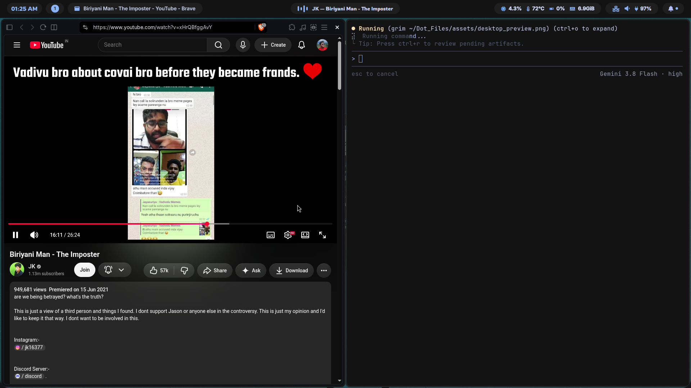
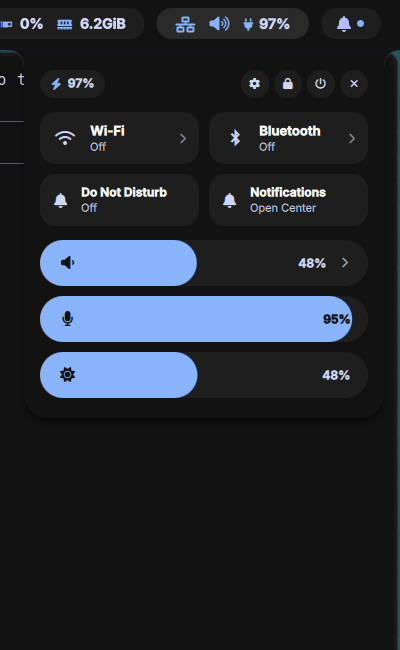
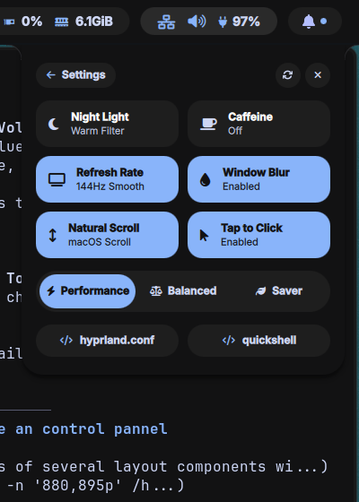

<div align="center">

# ❄️ Catppuccin Sapphire Hyprland + Quickshell

A modern, fluid, and cohesive Linux desktop environment powered by **Hyprland** and **Quickshell** in the **Catppuccin Sapphire** colorway.

[](https://hyprland.org)
[](https://quickshell.outfoxxed.me)
[](https://github.com/catppuccin/catppuccin)
[](LICENSE)

<br/>



</div>

<br/>

---

## ✨ Features

<table>
  <tr>
    <td width="50%" align="center">
      <b>🎛️ Main Control Panel</b><br/>
      <i>GNOME-style Quick Toggles & Trio of Pill Sliders</i><br/><br/>
      
    </td>
    <td width="50%" align="center">
      <b>⚙️ System Settings Panel</b><br/>
      <i>Unified 2×3 Grid & Sliding Power Profile</i><br/><br/>
      
    </td>
  </tr>
</table>

### 🌟 Desktop Shell & UI
- **Top Bar (`Bar.qml`):** Floating curved capsule with active workspaces, live clock & calendar, dynamic music ticker, and interactive system status pill.
- **Control Panel (`ControlPanel.qml`):**
  - Instantaneous 144Hz C++ PipeWire volume slider with audio sink switcher.
  - Dedicated microphone volume & mute slider.
  - Screen brightness slider with hardware backlight integration.
  - Wi-Fi, Bluetooth, Do Not Disturb, and Notification toggles.
- **System Settings Panel:**
  - **Night Light:** GPU fragment shader (`night-light.frag`) warm temperature filter.
  - **Caffeine Mode:** Prevents screen dimming and lock idle timers.
  - **Refresh Rate:** 144Hz Smooth vs 60Hz Battery Saver instant toggle.
  - **Window Blur:** Dynamic Hyprland blur toggle.
  - **Touchpad:** macOS Natural Scrolling & Tap to Click controls.
  - **Power Profiles:** 3-Way sliding pill for Performance, Balanced, and Power Saver.
  - **Quick Shortcuts:** Instant terminal shortcuts to `hyprland.conf` and `quickshell`.
- **Wallpapers (`WallpaperSelector.qml` & `WallpaperBackground.qml`):** Smooth cross-fade animation engine, category explorer, folder manager, and automatic synchronization with [`Wallpapers`](https://github.com/codemonkx/Wallpapers).
- **Notifications (`NotificationPanel.qml` & `NotificationToasts.qml`):** Floating toast banners and collapsible history center.
- **Lock Screen (`hyprlock.conf`):** Catppuccin Sapphire authentication card with blurred wallpaper backdrop.

---

## 🚀 One-Line Installation

Clone the repository and run the automated installer:

```bash
git clone https://github.com/codemonkx/Dot_Files.git ~/.dotfiles
cd ~/.dotfiles
./install.sh
```

### What the installer does:
1. Verifies and installs all required dependencies (`hyprland`, `quickshell`, `pipewire`, `wireplumber`, `brightnessctl`, `fonts`, etc.).
2. Creates a timestamped backup of your existing configs in `~/.config_backup_<timestamp>/`.
3. Symlinks all configuration directories (`hypr`, `quickshell`, `ghostty`, `cava`, `fastfetch`, `btop`, `fish`) into `~/.config/`.
4. Clones the official [`Wallpapers`](https://github.com/codemonkx/Wallpapers) repository into `~/Pictures/Wallpapers`.
5. Enables background system services (`power-profiles-daemon`, `bluetooth`).

---

## ⌨️ Keybindings Reference

| Shortcut | Description |
| :--- | :--- |
| <kbd>SUPER</kbd> + <kbd>SPACE</kbd> | Open App Launcher |
| <kbd>SUPER</kbd> + <kbd>A</kbd> | Toggle Main Control Panel |
| <kbd>SUPER</kbd> + <kbd>I</kbd> | Toggle System Settings Panel |
| <kbd>SUPER</kbd> + <kbd>W</kbd> | Open Wallpaper Selector |
| <kbd>SUPER</kbd> + <kbd>N</kbd> | Toggle Notification Center |
| <kbd>SUPER</kbd> + <kbd>M</kbd> | Toggle Full Media Player |
| <kbd>SUPER</kbd> + <kbd>Return</kbd> | Launch Ghostty Terminal |
| <kbd>SUPER</kbd> + <kbd>Q</kbd> | Close Active Window |
| <kbd>SUPER</kbd> + <kbd>L</kbd> | Lock Screen (`hyprlock`) |
| <kbd>SUPER</kbd> + <kbd>Esc</kbd> | Open Power Menu |
| <kbd>XF86AudioMute</kbd> | Toggle Speaker Mute (with OSD) |
| <kbd>XF86AudioMicMute</kbd> | Toggle Microphone Mute (with OSD) |
| <kbd>XF86AudioRaiseVolume</kbd> | Volume Up (with OSD) |
| <kbd>XF86AudioLowerVolume</kbd> | Volume Down (with OSD) |
| <kbd>XF86MonBrightnessUp</kbd> | Brightness Up (with OSD) |
| <kbd>XF86MonBrightnessDown</kbd> | Brightness Down (with OSD) |

---

## 📦 Required Dependencies

If you prefer to install dependencies manually:

### Core & Compositor
```bash
sudo pacman -S hyprland hypridle hyprlock swaybg pipewire wireplumber playerctl brightnessctl power-profiles-daemon upower networkmanager bluez bluez-utils wl-clipboard grim slurp jq python zenity ghostty fish fastfetch cava btop
```

### AUR Packages
```bash
yay -S quickshell-git
```

### Required Fonts
```bash
sudo pacman -S ttf-font-awesome ttf-inter ttf-jetbrains-mono-nerd
```

---

## 📂 Repository Layout

```
.
├── .config/
│   ├── hypr/               # Hyprland, hyprlock, hypridle, shaders & scripts
│   ├── quickshell/         # Complete QML desktop shell components
│   ├── ghostty/            # Terminal theme and typography
│   ├── fastfetch/          # Custom fastfetch ASCII art & spec sheet
│   ├── cava/               # Audio visualizer config & shaders
│   ├── btop/               # System monitor theme
│   └── fish/               # Fish shell configuration
├── assets/                 # Screenshots and preview media
├── install.sh              # Automated interactive installer
├── uninstall.sh            # Backup restorer & uninstaller
├── .gitignore              # Clean ignore rules
└── README.md               # Documentation
```

---

## 👤 Author

- **GitHub:** [@codemonkx](https://github.com/codemonkx)
- **Email:** [nithinx002@gmail.com](mailto:nithinx002@gmail.com)
