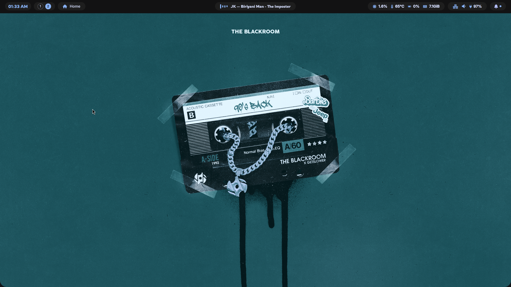
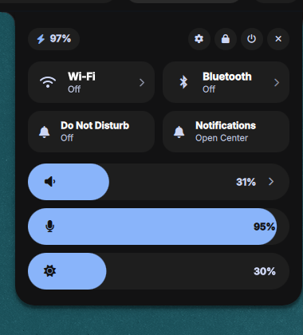
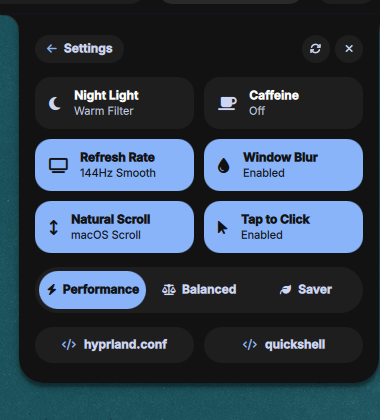
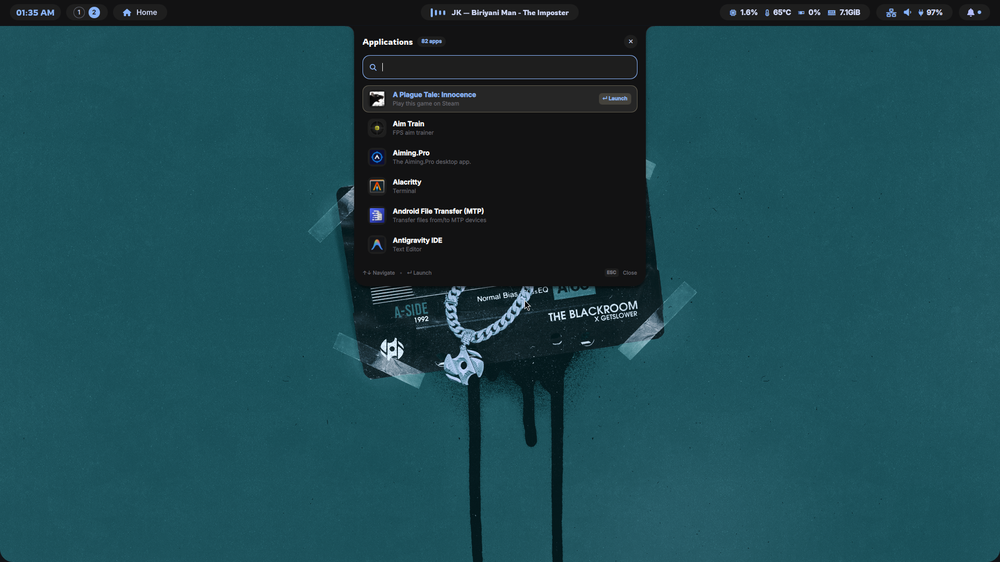
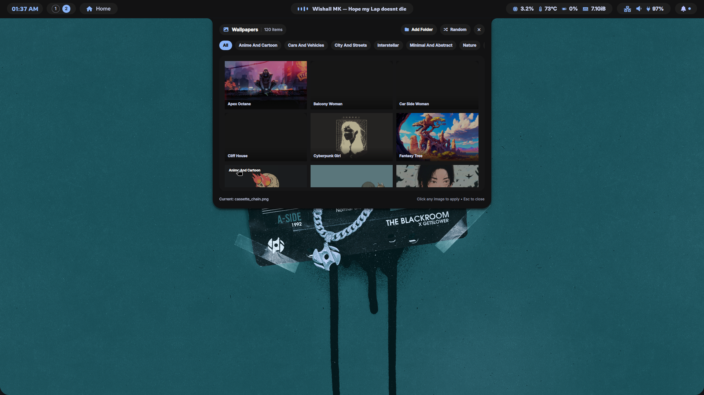
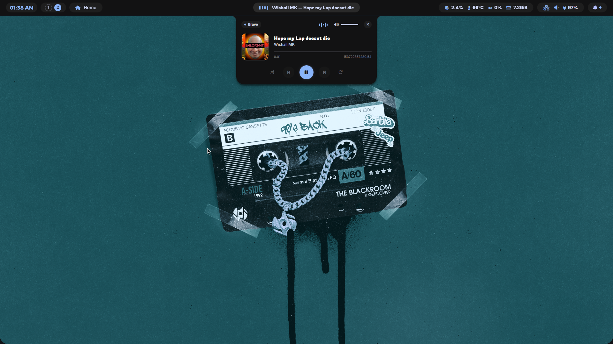
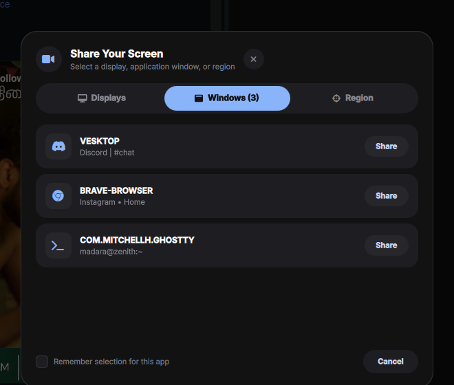

<div align="center">

# ❄️ Catppuccin Sapphire Hyprland + Quickshell

A modern, fluid, and cohesive Linux desktop environment powered by **Hyprland** and **Quickshell** in the **Catppuccin Sapphire** colorway.

[](https://hyprland.org)
[](https://quickshell.outfoxxed.me)
[](https://github.com/catppuccin/catppuccin)
[](LICENSE)

<br/>



</div>

<br/>

---

## ✨ Interface Showcase

<table>
  <tr>
    <td width="50%" align="center">
      <b>🎛️ Main Control Panel</b><br/>
      <i>GNOME-style Quick Toggles & Trio of Pill Sliders</i><br/><br/>
      
    </td>
    <td width="50%" align="center">
      <b>⚙️ System Settings Panel</b><br/>
      <i>Unified 2×3 Grid & Sliding Power Profile</i><br/><br/>
      
    </td>
  </tr>
  <tr>
    <td width="50%" align="center">
      <b>🚀 Application Launcher</b><br/>
      <i>Centered search & categorized quick launch</i><br/><br/>
      
    </td>
    <td width="50%" align="center">
      <b>🖼️ Animated Wallpaper Selector</b><br/>
      <i>Grid explorer, folder picker & cross-fade engine</i><br/><br/>
      
    </td>
  </tr>
  <tr>
    <td width="50%" align="center">
      <b>🎵 Full Media Player</b><br/>
      <i>Interactive playback, waveform visualizer & album art glow</i><br/><br/>
      
    </td>
    <td width="50%" align="center">
      <b>📺 Native Screen Share Picker</b><br/>
      <i>Catppuccin Sapphire picker for Vesktop, Discord & OBS</i><br/><br/>
      
    </td>
  </tr>
</table>

---

## 🌟 Desktop Shell & UI Features

- **Top Bar (`Bar.qml`):** Floating curved capsule with active workspaces, live clock & calendar, dynamic music ticker, and interactive system status pill.
- **Control Panel (`ControlPanel.qml`):**
  - Instantaneous 144Hz C++ PipeWire volume slider with audio sink switcher.
  - Dedicated microphone volume & mute slider with real-time feedback.
  - Screen brightness slider with hardware backlight integration.
  - Wi-Fi, Bluetooth, Do Not Disturb, and Notification toggles.
- **System Settings Panel:**
  - **Night Light:** GPU fragment shader (`night-light.frag`) warm temperature filter.
  - **Caffeine Mode:** Prevents screen dimming and lock idle timers.
  - **Refresh Rate:** 144Hz Smooth vs 60Hz Battery Saver instant toggle.
  - **Window Blur:** Dynamic Hyprland blur toggle.
  - **Touchpad:** macOS Natural Scrolling & Tap to Click controls.
  - **Power Profiles:** 3-Way sliding pill for Performance, Balanced, and Power Saver.
  - **Quick Shortcuts:** Instant terminal shortcuts to `hyprland.lua` and `quickshell`.
- **Screen Share Picker (`ScreenSharePicker.qml` & `share_picker.sh`):**
  - Replaces default Qt `hyprland-share-picker` with a native Catppuccin Sapphire Quickshell modal.
  - Direct integration with `xdg-desktop-portal-hyprland` via `~/.config/hypr/xdph.conf`.
  - 3-Way sliding pill for **Displays**, **Application Windows**, and **Region Selection** (`slurp`).
  - Automatic app icon mapping, workspace indicators, and token remember support.
- **Wallpapers (`WallpaperSelector.qml` & `WallpaperBackground.qml`):** Smooth cross-fade animation engine, category explorer, folder manager, and automatic synchronization with [`Wallpapers`](https://github.com/codemonkx/Wallpapers).
- **Notifications (`NotificationPanel.qml` & `NotificationToasts.qml`):** Floating toast banners and collapsible history center.
- **Lock Screen (`hyprlock.conf`):** Catppuccin Sapphire authentication card with blurred wallpaper backdrop.

---

## 🚀 One-Line Installation

Clone the repository and run the automated installer:

```bash
git clone https://github.com/codemonkx/Dot_Files.git ~/.dotfiles
cd ~/.dotfiles
./install.sh
```

### Installation Options:
- `./install.sh` (default): Performs clean, standalone copy of all configurations to `~/.config/`.
- `./install.sh --symlink`: Symlinks configuration directories from the repository to `~/.config/` (ideal for active git development).
- `./install.sh --yes`: Non-interactive deployment (great for automated script testing & VM spins).
- `./install.sh --dry-run`: Preview actions and check system compatibility without altering files.

### What the installer handles automatically:
1. **Hardware & VM Detection:** Detects whether you are running on bare metal or inside a Virtual Machine (QEMU, KVM, VirtualBox, VMware) and auto-configures display scaling and software cursors.
2. **Zero-Touch AUR Bootstrapping:** Automatically installs `yay-bin` if no AUR helper is present on the system.
3. **Typography & Font Cache:** Deploys bundled custom fonts (`Rowdies-Bold`, `Font Awesome 6 Pro`, `Inter`, `PixelifySans`) directly into `~/.local/share/fonts/kadal` and runs `fc-cache -f`.
4. **Configuration Deployment & Backup:** Creates a timestamped backup of existing configs in `~/.config_backup_<timestamp>/` before deploying.
5. **Desktop & Wallpaper Initialization:** Bundles and initializes a default high-resolution wallpaper (`~/Pictures/wall.jpg`) for immediate zero-touch first boot, with an optional prompt to clone the full 120-wallpaper pack.
6. **Background Services & Audio:** Enables `pipewire`, `wireplumber`, `pipewire-pulse`, `power-profiles-daemon`, and `bluetooth`.
7. **Post-Install Validation:** Automatically runs `hyprland --verify-config`, tests font availability, and confirms clipboard daemons.

---

## ⌨️ Keybindings Reference

| Shortcut | Description |
| :--- | :--- |
| <kbd>SUPER</kbd> + <kbd>SPACE</kbd> | Open App Launcher |
| <kbd>SUPER</kbd> + <kbd>A</kbd> | Toggle Main Control Panel |
| <kbd>SUPER</kbd> + <kbd>V</kbd> | Toggle Windows-style Clipboard History |
| <kbd>SUPER</kbd> + <kbd>.</kbd> | Open Emoji & Symbol Expression Flyout |
| <kbd>SUPER</kbd> + <kbd>I</kbd> | Toggle System Settings Panel |
| <kbd>SUPER</kbd> + <kbd>W</kbd> | Open Wallpaper Selector |
| <kbd>SUPER</kbd> + <kbd>Shift</kbd> + <kbd>S</kbd> | GNOME-style Interactive Screenshot Tool |
| <kbd>Print</kbd> | GNOME-style Interactive Screenshot Tool |
| <kbd>SUPER</kbd> + <kbd>N</kbd> | Toggle Notification Center |
| <kbd>SUPER</kbd> + <kbd>M</kbd> | Toggle Full Media Player |
| <kbd>SUPER</kbd> + <kbd>Return</kbd> | Launch Ghostty Terminal |
| <kbd>SUPER</kbd> + <kbd>Q</kbd> | Close Active Window |
| <kbd>SUPER</kbd> + <kbd>L</kbd> | Lock Screen (`hyprlock`) |
| <kbd>SUPER</kbd> + <kbd>Esc</kbd> | Open Power Menu |
| <kbd>XF86AudioMute</kbd> | Toggle Speaker Mute (with OSD) |
| <kbd>XF86AudioMicMute</kbd> | Toggle Microphone Mute (with OSD) |
| <kbd>XF86AudioRaiseVolume</kbd> | Volume Up (with OSD) |
| <kbd>XF86AudioLowerVolume</kbd> | Volume Down (with OSD) |
| <kbd>XF86MonBrightnessUp</kbd> | Brightness Up (with OSD) |
| <kbd>XF86MonBrightnessDown</kbd> | Brightness Down (with OSD) |

---

## 📦 Required Dependencies & Essential Applications

If you prefer to install software manually or verify your environment:

### 1. Essential Desktop & Everyday Apps
| Application | Category | Package | Description |
| :--- | :--- | :--- | :--- |
| **Nautilus** | File Manager | `nautilus` | Sleek GTK4 file manager with dark theme support |
| **Micro** | Terminal Editor | `micro` | Modern terminal text editor with mouse support & standard shortcuts |
| **Vesktop** | Discord Client | `vesktop-bin` | Wayland-optimized Discord client with screen audio sharing |
| **Steam** | Gaming Platform | `steam` | Valve gaming client with Proton/Wine compatibility |
| **Brave** | Web Browser | `brave-bin` | Fast, privacy-oriented web browser |
| **Loupe** | Image Viewer | `loupe` | Fast image viewer for GNOME/Wayland |
| **File Roller** | Archive Manager | `file-roller` | Archive manager for `.zip`, `.tar.gz`, `.7z`, and `.rar` |
| **Pavucontrol** | Audio Device Manager | `pavucontrol` | Detailed PipeWire/PulseAudio input/output switcher |
| **Hyprpolkitagent** | Auth Agent | `hyprpolkitagent` | Polkit authentication agent for privilege escalation |

```bash
# Official repository apps
sudo pacman -S nautilus micro steam loupe file-roller pavucontrol hyprpolkitagent vlc

# AUR apps (Vesktop & Brave)
yay -S vesktop-bin brave-bin
# (Or via Flatpak: flatpak install flathub dev.vencord.Vesktop com.brave.Browser)
```

---

### 2. Core Compositor & Environment
```bash
sudo pacman -S hyprland hypridle hyprlock swaybg pipewire wireplumber playerctl brightnessctl power-profiles-daemon upower networkmanager bluez bluez-utils wl-clipboard grim slurp jq python zenity ghostty fish fastfetch cava btop
```

### 3. AUR Desktop Shell
```bash
yay -S quickshell-git
```

### 4. Required Fonts
```bash
sudo pacman -S ttf-font-awesome ttf-inter ttf-jetbrains-mono-nerd
```

---

## 📂 Repository Layout

```
.
├── .config/
│   ├── hypr/               # Hyprland, hyprlock, hypridle, shaders & scripts
│   ├── quickshell/         # Complete QML desktop shell components
│   ├── ghostty/            # Terminal theme and typography
│   ├── fastfetch/          # Custom fastfetch ASCII art & spec sheet
│   ├── cava/               # Audio visualizer config & shaders
│   ├── btop/               # System monitor theme
│   └── fish/               # Fish shell configuration
├── assets/                 # High-resolution screenshots and showcase media
├── install.sh              # Automated interactive installer
├── uninstall.sh            # Backup restorer & uninstaller
├── .gitignore              # Clean ignore rules
└── README.md               # Documentation & keybinding guide
```

---

## 👤 Author

- **GitHub:** [@codemonkx](https://github.com/codemonkx)
- **Email:** [nithinx002@gmail.com](mailto:nithinx002@gmail.com)
