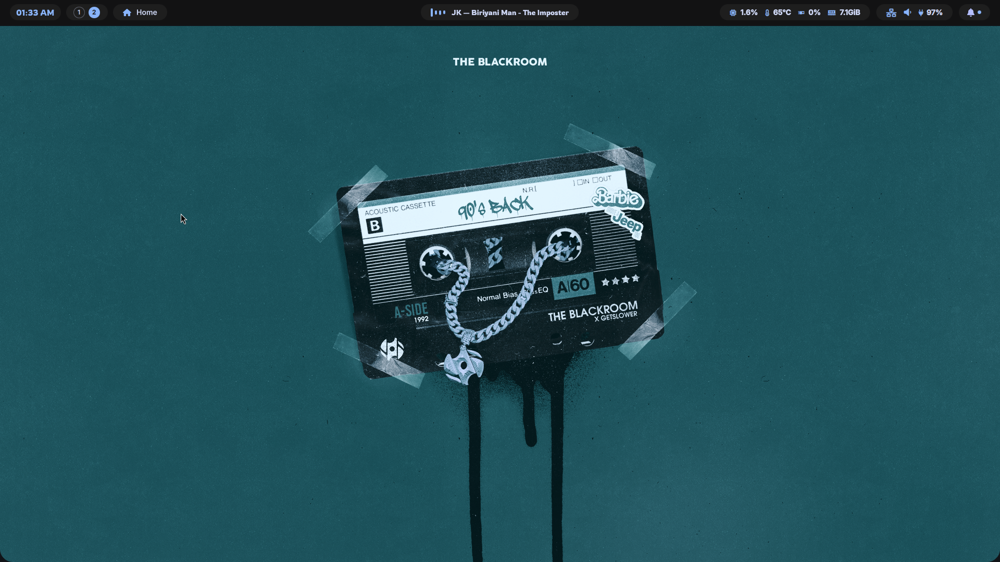
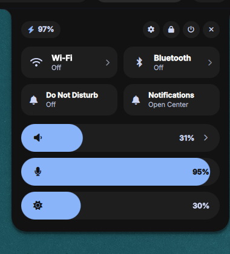
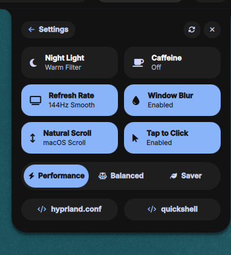
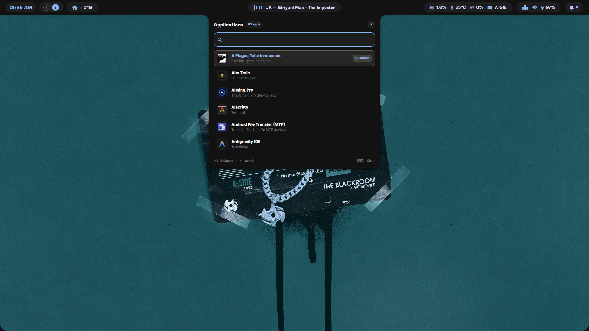
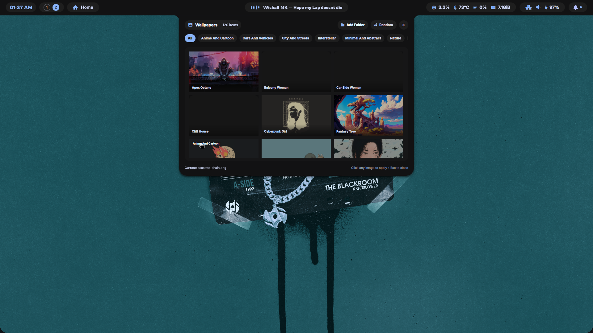
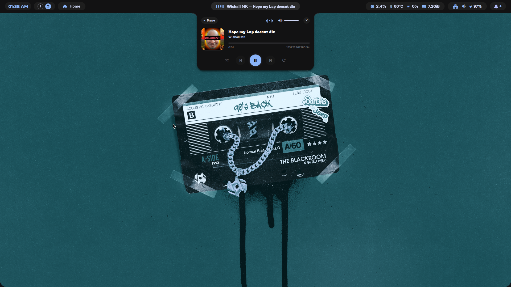
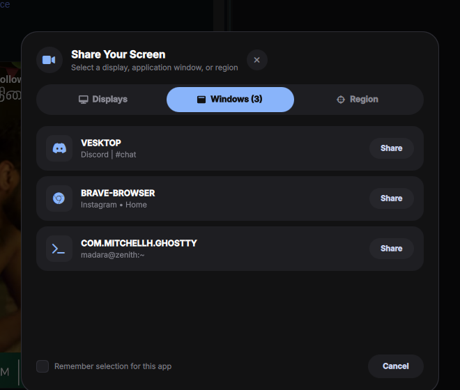

<div align="center">

# ❄️ Catppuccin Sapphire Hyprland + Quickshell

A modern, fluid, and cohesive Linux desktop environment powered by **Hyprland (Lua 0.57+)** and **Quickshell** in the **Catppuccin Sapphire** colorway.

[](https://hyprland.org)
[](https://quickshell.outfoxxed.me)
[](https://github.com/catppuccin/catppuccin)
[](LICENSE)

<br/>



</div>

<br/>

---

## ✨ Interface Showcase

<table>
  <tr>
    <td width="50%" align="center">
      <b>🎛️ Main Control Panel</b><br/>
      <i>GNOME-style Quick Toggles & Trio of Pill Sliders</i><br/><br/>
      
    </td>
    <td width="50%" align="center">
      <b>⚙️ System Settings Panel</b><br/>
      <i>Unified Grid & Sliding Power Profile</i><br/><br/>
      
    </td>
  </tr>
  <tr>
    <td width="50%" align="center">
      <b>🚀 Application Launcher</b><br/>
      <i>Centered search & categorized quick launch</i><br/><br/>
      
    </td>
    <td width="50%" align="center">
      <b>🖼️ Animated Wallpaper Selector</b><br/>
      <i>Grid explorer, folder picker & cross-fade engine</i><br/><br/>
      
    </td>
  </tr>
  <tr>
    <td width="50%" align="center">
      <b>🎵 Full Media Player</b><br/>
      <i>Interactive playback, waveform visualizer & album art glow</i><br/><br/>
      
    </td>
    <td width="50%" align="center">
      <b>📺 Native Screen Share Picker</b><br/>
      <i>Catppuccin Sapphire picker for Vesktop, Discord & OBS</i><br/><br/>
      
    </td>
  </tr>
</table>

---

## 🌟 Desktop Features & Architecture

- **Modular Hyprland (0.57+ Lua):**
  - Fully migrated to Hyprland's native Lua configuration engine.
  - Organized modularly: `keybinds.lua`, `userprefs.lua`, `autostart.lua`, `windowrules.lua`, `monitors.lua`, `animations.lua`, and `colors.lua`.
  - Native fallback displays, laptop lid switch handling, and dynamic cursor submap.

- **Modular Quickshell Architecture:**
  - **Styles:** Switch seamlessly between **Convex** (organic curved frames) and **Island** (floating pill bar with expandable widgets).
  - **Unified `widgets` IPC Engine:** All drawers and panels run through an optimized IPC singleton (`qs ipc call widgets toggle <widgetId>`).
  - **Top Bar (`Modules/Bar/`):** Active workspaces, dynamic music ticker, live clock & calendar, and tray management.
  - **Control Center (`Modules/ControlCenter/`):** Real-time PipeWire volume sliders, microphone controls, screen brightness, Wi-Fi & Bluetooth management, and power profile switching.
  - **Power Menu (`Modules/PowerMenu/`):** Quick Lock (`hyprlock`), Suspend (`systemctl suspend`), Logout (`hyprctl dispatch exit`), Reboot, and Shutdown with confirmation protection.
  - **Application Launcher (`Modules/Launcher/`):** Fuzzy application search, categorized drawer, and frequency sorting.
  - **Wallpaper Selector (`Modules/WallpaperSelector/`):** Live wallpaper browser with smooth background transitions via `awww-daemon`.
  - **System Usage & Monitor (`Modules/SystemUsage/`):** Real-time CPU, GPU (NVIDIA / Intel), RAM, and swap tracking.

- **Dual-GPU Battery & Performance Optimization (`environment.d/gpu.conf`):**
  - Configured with `AQ_DRM_DEVICES=/dev/dri/card2:/dev/dri/card1` to drive desktop compositing on the power-efficient Intel integrated GPU while keeping the NVIDIA RTX 3050 discrete GPU available on demand for games and 3D rendering.

- **Clipboard & Utilities:**
  - Clipboard history manager with `cliphist` integration (`SUPER + V`).
  - Native screen magnifier, OCR, and GNOME-style screenshot overlay (`SUPER + SHIFT + S`).

---

## ⌨️ Keybindings Reference

### Window & Session Management
| Shortcut | Action |
| :--- | :--- |
| <kbd>SUPER</kbd> + <kbd>Return</kbd> | Launch Primary Terminal (`ghostty` / `kitty`) |
| <kbd>SUPER</kbd> + <kbd>Shift</kbd> + <kbd>Return</kbd> | Launch Floating Terminal |
| <kbd>SUPER</kbd> + <kbd>E</kbd> | Open File Manager (`nautilus`) |
| <kbd>SUPER</kbd> + <kbd>B</kbd> | Open Web Browser (`brave`) |
| <kbd>SUPER</kbd> + <kbd>Q</kbd> | Close Active Window |
| <kbd>SUPER</kbd> + <kbd>Shift</kbd> + <kbd>M</kbd> | Exit Hyprland |
| <kbd>SUPER</kbd> + <kbd>L</kbd> | Lock Screen (`hyprlock`) |
| <kbd>SUPER</kbd> + <kbd>Esc</kbd> *(or <kbd>Ctrl</kbd>+<kbd>Alt</kbd>+<kbd>X</kbd>)* | Toggle Power Menu |
| <kbd>SUPER</kbd> + <kbd>W</kbd> | Toggle Floating Mode |
| <kbd>SUPER</kbd> + <kbd>F</kbd> | Toggle Maximized Window |
| <kbd>SUPER</kbd> + <kbd>Shift</kbd> + <kbd>F</kbd> | Toggle True Fullscreen |

### Quickshell Widgets & Apps
| Shortcut | Action |
| :--- | :--- |
| <kbd>SUPER</kbd> + <kbd>SPACE</kbd> *(or <kbd>SUPER</kbd>+<kbd>A</kbd>)* | Toggle Application Launcher |
| <kbd>Ctrl</kbd> + <kbd>Alt</kbd> + <kbd>S</kbd> | Toggle Control Center |
| <kbd>Ctrl</kbd> + <kbd>Alt</kbd> + <kbd>N</kbd> | Toggle Notifications Center |
| <kbd>Ctrl</kbd> + <kbd>Alt</kbd> + <kbd>D</kbd> | Toggle Dashboard |
| <kbd>Ctrl</kbd> + <kbd>Alt</kbd> + <kbd>M</kbd> | Toggle Full Music Player |
| <kbd>Ctrl</kbd> + <kbd>Alt</kbd> + <kbd>C</kbd> | Toggle Calendar |
| <kbd>Ctrl</kbd> + <kbd>Alt</kbd> + <kbd>F</kbd> | Toggle System Usage / Performance Stats |
| <kbd>SUPER</kbd> + <kbd>V</kbd> | Toggle Clipboard History |
| <kbd>SUPER</kbd> + <kbd>Shift</kbd> + <kbd>S</kbd> | Interactive Area Screenshot |
| <kbd>SUPER</kbd> + <kbd>S</kbd> | Open Minflair Settings App |
| <kbd>SUPER</kbd> + <kbd>K</kbd> | Open Keybinds Cheat Sheet |
| <kbd>SUPER</kbd> + <kbd>Shift</kbd> + <kbd>C</kbd> | Color Picker (`hyprpicker`) |

### Media & Hardware Controls
| Shortcut | Action |
| :--- | :--- |
| <kbd>XF86AudioRaiseVolume</kbd> | Raise Volume (with OSD) |
| <kbd>XF86AudioLowerVolume</kbd> | Lower Volume (with OSD) |
| <kbd>XF86AudioMute</kbd> | Toggle Audio Mute |
| <kbd>XF86AudioMicMute</kbd> | Toggle Microphone Mute |
| <kbd>XF86MonBrightnessUp</kbd> | Increase Brightness (with OSD) |
| <kbd>XF86MonBrightnessDown</kbd> | Decrease Brightness (with OSD) |
| <kbd>XF86AudioPlay</kbd> | Play / Pause Media |
| <kbd>XF86AudioNext</kbd> | Next Track |
| <kbd>XF86AudioPrev</kbd> | Previous Track |

---

## 📂 Repository Layout

```
.
├── .config/
│   ├── environment.d/      # Dual-GPU (Intel + NVIDIA) & dynamic loader variables
│   │   ├── gpu.conf        # AQ_DRM_DEVICES optimization
│   │   └── chromaleon.conf # Dynamic accent color injection
│   ├── hypr/               # Modular Hyprland Lua configuration
│   │   ├── hyprland.lua    # Main entry point & modules inclusion
│   │   ├── keybinds.lua    # Comprehensive desktop keybindings
│   │   ├── userprefs.lua   # Input, cursor, animations & visual settings
│   │   ├── autostart.lua   # Daemons & background services bootstrap
│   │   ├── windowrules.lua # App floating rules, window sizing & dialogs
│   │   ├── monitors.lua    # Displays & monitor overrides
│   │   ├── hypridle.conf   # Idle timeouts & power management
│   │   ├── hyprlock.conf   # Screen locker layout & styling
│   │   └── scripts/        # Volume, brightness, touchpad & lock scripts
│   ├── quickshell/         # Modular Quickshell desktop environment
│   │   ├── Core/           # Shared components, services, and windows
│   │   ├── Modules/        # Bar, Launcher, ControlCenter, PowerMenu, etc.
│   │   ├── Scripts/        # Helper Python scripts for system operations
│   │   ├── assets/         # SVG icons & vector assets
│   │   └── shell.qml       # Main Quickshell entrypoint & IPC router
│   ├── ghostty/            # Ghostty terminal config & theme
│   ├── fish/               # Fish shell configuration
│   ├── fastfetch/          # Custom fastfetch ASCII art & spec sheet
│   ├── cava/               # Audio visualizer config & shaders
│   └── btop/               # System monitor theme
├── assets/                 # High-resolution screenshots and showcase media
├── install.sh              # Automated interactive installer
├── uninstall.sh            # Backup restorer & uninstaller
├── .gitignore              # Clean ignore rules
└── README.md               # Documentation & setup guide
```

---

## 🚀 Installation & Setup

1. **Clone the repository:**
   ```bash
   git clone https://github.com/codemonkx/Dot_Files.git ~/Dot_Files
   cd ~/Dot_Files
   ```

2. **Symlink to `~/.config/` (Recommended):**
   ```bash
   ln -sfn ~/Dot_Files/.config/hypr ~/.config/hypr
   ln -sfn ~/Dot_Files/.config/quickshell ~/.config/quickshell
   ln -sfn ~/Dot_Files/.config/environment.d ~/.config/environment.d
   ```

3. **Install Core Packages (Arch / CachyOS):**
   ```bash
   sudo pacman -S hyprland hypridle hyprlock pipewire wireplumber brightnessctl power-profiles-daemon bluez bluez-utils wl-clipboard cliphist ghostty kitty fish fastfetch btop
   yay -S quickshell-git awww-daemon hyprpicker
   ```

4. **Reload Environment:**
   ```bash
   hyprctl reload
   ```

---

## 👤 Author

- **GitHub:** [@codemonkx](https://github.com/codemonkx)
- **Email:** [nithinx002@gmail.com](mailto:nithinx002@gmail.com)
